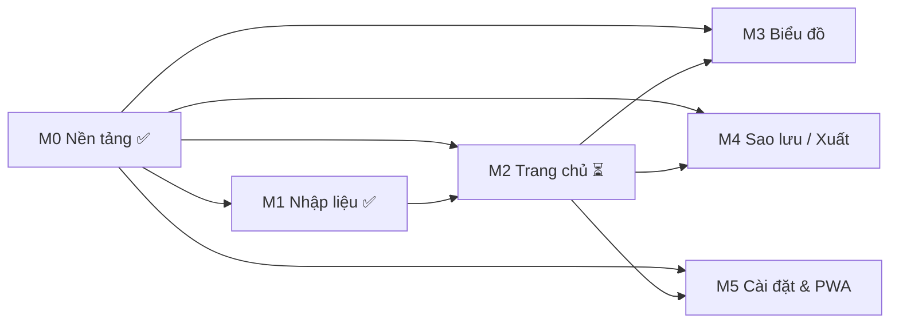
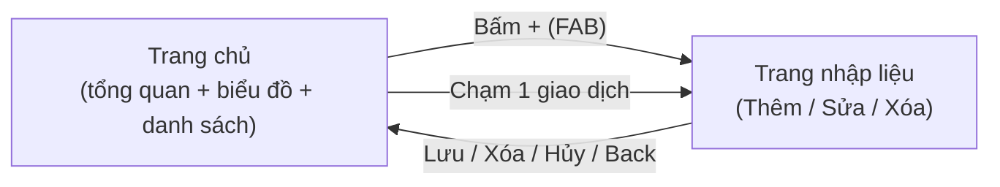

# PRD – Ứng dụng Ghi chép Thu/Chi cá nhân ("Sổ Thu Chi")

| Mục | Nội dung |
|---|---|
| Phiên bản tài liệu | 1.1 (thêm mục 4.4 – Phân chia module) |
| Ngày | 27/10/2026 |
| Trạng thái | Bản nháp – chờ duyệt |
| Tài liệu liên quan | [DESIGN.md](DESIGN.md) |

---

## 1. Tổng quan ứng dụng

**Sổ Thu Chi** là một web app cá nhân, giúp người dùng ghi lại các khoản thu và chi hằng ngày một cách nhanh chóng, sau đó xem tổng quan tài chính theo tháng qua các con số và biểu đồ.

- **Hình thức:** Web app responsive, cài được lên màn hình chính như ứng dụng (PWA), dùng tốt trên cả điện thoại và laptop.
- **Dữ liệu:** Lưu trực tiếp trên thiết bị (IndexedDB), **không cần đăng nhập**, **hoạt động offline**.
- **Phạm vi giao diện:** 2 màn hình:
  1. **Trang chủ** – tổng quan tháng (thẻ tổng, biểu đồ) + danh sách giao dịch.
  2. **Trang nhập liệu** – thêm mới / sửa / xóa một khoản thu hoặc chi.
- **Đơn vị tiền tệ:** VND (₫), số nguyên, không có phần thập phân.

## 2. Mục tiêu ứng dụng

| # | Mục tiêu | Diễn giải |
|---|---|---|
| G1 | **Ghi nhanh** | Ghi 1 khoản chi trong ≤ 10 giây, ≤ 4 thao tác từ lúc mở app. |
| G2 | **Hiểu nhanh** | Mở app là thấy ngay tháng này đã thu bao nhiêu, chi bao nhiêu, còn dư bao nhiêu. |
| G3 | **Biết tiền đi đâu** | Thấy được tỷ trọng chi theo danh mục và xu hướng theo ngày/tháng. |
| G4 | **Riêng tư & đơn giản** | Không tài khoản, không máy chủ; dữ liệu chỉ nằm trên thiết bị của người dùng. |
| G5 | **Dùng mọi lúc** | Chạy offline, tải nhanh trên điện thoại. |

## 3. Đối tượng người dùng và User Stories

### 3.1. Chân dung người dùng

| Persona | Mô tả | Nhu cầu chính |
|---|---|---|
| **Minh – nhân viên văn phòng, 26 tuổi** | Có lương cố định, hay chi lặt vặt (ăn uống, cà phê, Grab). Dùng điện thoại là chính. | Ghi nhanh ngay sau khi trả tiền; cuối tháng xem đã tiêu vào đâu nhiều nhất. |
| **Lan – sinh viên, 20 tuổi** | Thu nhập từ gia đình + làm thêm, ngân sách eo hẹp. | Biết còn bao nhiêu tiền trong tháng, tránh tiêu quá tay. |
| **Hùng – freelancer, 32 tuổi** | Thu nhập không đều, làm việc trên laptop. | So sánh thu/chi giữa các tháng để thấy tháng nào âm. |

Đặc điểm chung: **một người dùng / một thiết bị**, không chia sẻ sổ, không cần kiến thức kế toán.

### 3.2. User Stories

| ID | Là… | Tôi muốn… | Để… | Ưu tiên |
|---|---|---|---|---|
| US-01 | người dùng | thêm một khoản **chi** với số tiền, danh mục, ngày, ghi chú | ghi lại tiền đã tiêu | Must |
| US-02 | người dùng | thêm một khoản **thu** | ghi lại tiền nhận được | Must |
| US-03 | người dùng | ngày mặc định là hôm nay | không phải chọn ngày mỗi lần | Must |
| US-04 | người dùng | thấy tổng Thu / Chi / Số dư của tháng ngay trên trang chủ | nắm tình hình tài chính trong 1 giây | Must |
| US-05 | người dùng | chuyển qua lại giữa các tháng | xem lại các tháng trước | Must |
| US-06 | người dùng | xem danh sách giao dịch trong tháng, nhóm theo ngày | kiểm tra lại mình đã ghi gì | Must |
| US-07 | người dùng | chạm vào một giao dịch để sửa | sửa khi nhập sai | Must |
| US-08 | người dùng | xóa một giao dịch (có xác nhận / hoàn tác) | bỏ khoản ghi nhầm mà không sợ xóa nhầm | Must |
| US-09 | người dùng | xem biểu đồ tròn chi theo danh mục | biết tiền đi đâu nhiều nhất | Must |
| US-10 | người dùng | xem biểu đồ cột thu/chi theo ngày trong tháng | thấy ngày nào chi đột biến | Should |
| US-11 | người dùng | so sánh thu/chi 6 tháng gần nhất | thấy xu hướng dài hạn | Should |
| US-12 | người dùng | lọc danh sách theo Thu / Chi / Tất cả | tập trung vào loại mình quan tâm | Should |
| US-13 | người dùng | sao lưu và khôi phục dữ liệu (file JSON) | không mất dữ liệu khi đổi máy / xóa trình duyệt | Should |
| US-14 | người dùng | cài app lên màn hình chính và dùng offline | mở nhanh như app thật | Should |
| US-15 | người dùng | dùng chế độ tối | đỡ chói mắt ban đêm | Should |
| US-16 | người dùng | chạm vào một lát biểu đồ tròn để lọc danh sách theo danh mục đó | xem chi tiết các khoản trong danh mục | Could |
| US-17 | người dùng | xuất dữ liệu ra CSV | mở bằng Excel/Google Sheets | Could |

## 4. Danh sách chức năng chính

### 4.1. Bảng chức năng & độ ưu tiên

| ID | Chức năng | Mô tả | Màn hình | Ưu tiên |
|---|---|---|---|---|
| F-01 | Thêm giao dịch | Chọn loại Thu/Chi, nhập số tiền, chọn danh mục, ngày (mặc định hôm nay), ghi chú (tùy chọn). | Nhập liệu | **Must** |
| F-02 | Sửa giao dịch | Mở giao dịch có sẵn ở Trang nhập liệu với dữ liệu điền sẵn, lưu thay đổi. | Nhập liệu | **Must** |
| F-03 | Xóa giao dịch | Nút Xóa trong chế độ sửa → hộp xác nhận → xóa; toast "Đã xóa" kèm **Hoàn tác** (5 giây). | Nhập liệu | **Must** |
| F-04 | Thẻ tổng quan tháng | 3 chỉ số: Tổng thu, Tổng chi, Số dư (= Thu − Chi) của tháng đang chọn. | Trang chủ | **Must** |
| F-05 | Chọn tháng | Nút ‹ / › và nhãn "Tháng 10/2026"; chạm nhãn để quay về tháng hiện tại. | Trang chủ | **Must** |
| F-06 | Danh sách giao dịch | Các giao dịch trong tháng, nhóm theo ngày (mới nhất trên cùng), có tổng chi/thu của từng ngày. | Trang chủ | **Must** |
| F-07 | Biểu đồ tròn (donut) chi theo danh mục | Tỷ trọng chi từng danh mục, kèm chú thích % và số tiền. | Trang chủ | **Must** |
| F-08 | Danh mục cố định | Bộ danh mục có sẵn, không cho người dùng thêm/sửa (xem 4.2). | Cả hai | **Must** |
| F-09 | Lưu trữ cục bộ | Lưu toàn bộ dữ liệu vào IndexedDB, giữ nguyên khi tải lại trang. | — | **Must** |
| F-10 | Kiểm tra dữ liệu nhập | Số tiền > 0 và ≤ 999.999.999.999; bắt buộc chọn danh mục; ngày không vượt quá hôm nay + 1 năm. | Nhập liệu | **Must** |
| F-11 | Responsive | Bố cục 1 cột trên điện thoại, 2 cột trên laptop (xem DESIGN.md §4). | Cả hai | **Must** |
| F-12 | Biểu đồ cột thu/chi theo ngày | Cột đôi Thu/Chi cho từng ngày trong tháng. | Trang chủ | **Should** |
| F-13 | So sánh 6 tháng | Cột đôi Thu/Chi của 6 tháng gần nhất (tính tới tháng đang chọn). | Trang chủ | **Should** |
| F-14 | Lọc danh sách | Bộ lọc Tất cả / Thu / Chi cho danh sách giao dịch. | Trang chủ | **Should** |
| F-15 | Sao lưu / Khôi phục | Xuất toàn bộ dữ liệu ra file `.json`; nhập lại từ file (thay thế hoặc gộp). | Trang chủ (menu ⋮) | **Should** |
| F-16 | PWA & offline | Manifest + Service Worker, cài được, chạy không cần mạng. | — | **Should** |
| F-17 | Chế độ sáng/tối | Theo hệ thống, có nút chuyển thủ công trong menu. | Cả hai | **Should** |
| F-18 | Định dạng tiền khi gõ | Tự chèn dấu chấm phân cách hàng nghìn (150.000); có gợi ý nhanh "000". | Nhập liệu | **Should** |
| F-19 | Lọc theo danh mục từ biểu đồ | Chạm lát donut → danh sách chỉ hiện danh mục đó. | Trang chủ | **Could** |
| F-20 | Xuất CSV | Xuất giao dịch của tháng ra `.csv`. | Trang chủ (menu ⋮) | **Could** |
| F-21 | Tìm kiếm theo ghi chú | Ô tìm kiếm trong danh sách. | Trang chủ | **Could** |

### 4.2. Danh mục cố định

| Loại | Danh mục (mã – tên) |
|---|---|
| **Chi** | `food` Ăn uống · `transport` Đi lại · `shopping` Mua sắm · `bills` Hóa đơn & Nhà ở · `entertainment` Giải trí · `health` Sức khỏe · `education` Học tập · `other_expense` Khác |
| **Thu** | `salary` Lương · `bonus` Thưởng · `side_income` Thu nhập phụ · `gift` Được tặng · `other_income` Khác |

### 4.3. Mô hình dữ liệu

```ts
type TransactionType = 'income' | 'expense';

interface Transaction {
  id: string;            // UUID v4
  type: TransactionType;
  amount: number;        // VND, số nguyên dương
  categoryId: string;    // mã danh mục ở bảng 4.2
  date: string;          // 'YYYY-MM-DD' (ngày giao dịch, theo giờ địa phương)
  note?: string;         // tối đa 100 ký tự
  createdAt: number;     // epoch ms
  updatedAt: number;     // epoch ms
}
```

- Chỉ mục IndexedDB: `date`, `[type+date]` để truy vấn theo tháng nhanh.
- File sao lưu: `{ "app": "so-thu-chi", "version": 1, "exportedAt": "...", "transactions": [...] }`.

### 4.4. Phân chia module

Ứng dụng được chia thành **6 module**. Mỗi module xây, test và nghiệm thu riêng. Các module chỉ giao tiếp với nhau qua những "điểm nối" ghi ở mục 4.4.4, không sửa code bên trong module khác.

#### 4.4.1. Tổng quan các module

| Module | Tên | Chức năng (ID ở 4.1) | Vị trí trên giao diện | Ưu tiên | Phụ thuộc | Trạng thái |
|---|---|---|---|---|---|---|
| **M0** | Nền tảng (dùng chung) | F-08, F-09, F-11 + bộ quy tắc của F-10 | Không có màn hình riêng | Must | — | ✅ Đã có (xây cùng M1) |
| **M1** | Nhập liệu thu/chi | F-01, F-02, F-03, F-10, F-18 | Trang nhập liệu `/new`, `/edit/:id` | Must | M0 | ✅ Hoàn thành |
| **M2** | Trang chủ – Tổng quan & Danh sách | F-04, F-05, F-06, F-14, F-21 | Trang chủ `/` (thẻ tổng, chọn tháng, danh sách) | Must | M0, M1 | ⏳ Làm tiếp theo |
| **M3** | Biểu đồ | F-07, F-12, F-13, F-19 | Thẻ biểu đồ trên Trang chủ | Must (F-07) | M0, M2 | ⬜ Chưa làm |
| **M4** | Quản lý dữ liệu – Sao lưu, Khôi phục, Xuất | F-15, F-20 | Menu ⋮ → bottom sheet / dialog | Should | M0, M2 | ⬜ Chưa làm |
| **M5** | Cài đặt & PWA | F-16, F-17 | Menu ⋮, banner, toàn app | Should | M0, M2 | ⬜ Chưa làm |

Mọi chức năng **Must** đều nằm trong M0–M3. Khi xong M3, app đạt mức **MVP** (bản tối thiểu dùng được).

#### 4.4.2. Bảng tra: chức năng → module

| ID | Chức năng | Ưu tiên | Module | Ghi chú |
|---|---|---|---|---|
| F-01 | Thêm giao dịch | Must | M1 | ✅ |
| F-02 | Sửa giao dịch | Must | M1 | ✅ |
| F-03 | Xóa giao dịch (+ Hoàn tác) | Must | M1 | ✅ |
| F-04 | Thẻ tổng quan tháng | Must | M2 | |
| F-05 | Chọn tháng | Must | M2 | Gồm bộ chọn tháng/năm (DESIGN §10.5) |
| F-06 | Danh sách giao dịch | Must | M2 | Chạm 1 dòng → mở `/edit/:id` của M1 |
| F-07 | Donut chi theo danh mục | Must | M3 | |
| F-08 | Danh mục cố định | Must | M0 | ✅ |
| F-09 | Lưu trữ cục bộ (IndexedDB) | Must | M0 | ✅ |
| F-10 | Kiểm tra dữ liệu nhập | Must | M1 | Quy tắc nằm ở M0, giao diện báo lỗi ở M1. ✅ |
| F-11 | Responsive | Must | M0 + mọi module | M0 cung cấp design tokens & breakpoints; mỗi module tự làm bố cục của mình |
| F-12 | Cột thu/chi theo ngày | Should | M3 | |
| F-13 | So sánh 6 tháng | Should | M3 | |
| F-14 | Lọc Tất cả / Thu / Chi | Should | M2 | |
| F-15 | Sao lưu / Khôi phục JSON | Should | M4 | Kèm banner nhắc sao lưu |
| F-16 | PWA & offline | Should | M5 | |
| F-17 | Chế độ sáng/tối | Should | M5 | M0 đã có sẵn bảng màu tối; M5 làm nút chuyển trong menu |
| F-18 | Định dạng tiền khi gõ | Should | M1 | ✅ |
| F-19 | Lọc theo danh mục từ donut | Could | M3 | Cần trạng thái bộ lọc do M2 cung cấp |
| F-20 | Xuất CSV | Could | M4 | |
| F-21 | Tìm kiếm theo ghi chú | Could | M2 | |

#### 4.4.3. Chi tiết từng module

**M0 – Nền tảng (dùng chung)** ✅
- **Phạm vi:** design tokens màu, chữ, khoảng cách, chế độ tối (DESIGN §2–§5, §8); mô hình dữ liệu (4.3); cơ sở dữ liệu IndexedDB qua Dexie; lớp truy cập dữ liệu `transactionRepo`; quy tắc kiểm tra dữ liệu; tiện ích định dạng tiền và ngày; danh mục cố định; router; các thành phần dùng chung Toast và ConfirmDialog.
- **Thư mục:** `src/styles`, `src/data`, `src/lib`, `src/components`, `src/app`.
- **Ghi chú:** khi module sau cần thêm hàm truy vấn hoặc thành phần dùng chung, bổ sung vào M0 và kèm test.
  - M2 cần thêm hàm lấy giao dịch theo tháng và theo khoảng ngày.
  - M4 cần thêm hàm lấy tất cả, ghi nhiều bản ghi một lần và xóa toàn bộ.
  - M4 và M5 cần thêm các thành phần Bottom Sheet, Banner, Menu (DESIGN §10.9, §10.10).

**M1 – Nhập liệu thu/chi** ✅
- **Phạm vi:** thêm, sửa, xóa giao dịch, Hoàn tác xóa, kiểm tra dữ liệu, định dạng tiền khi gõ, hỏi "Bỏ thay đổi?" khi rời trang.
- **Giao diện:** DESIGN §4.4, §6.5, §6.8–§6.13, §9.2.
- **Thư mục:** `src/features/entry`.
- **Kết quả:** 196 test tự động đều qua (tính cả các test của M0).

**M2 – Trang chủ: Tổng quan & Danh sách** ⏳
- **Phạm vi:**
  - App bar có nút ⋮; các mục trong menu do M4 và M5 bổ sung sau.
  - Chọn tháng: nút ‹ ›, bộ chọn tháng/năm, nút "Về tháng này".
  - Thẻ tổng Thu / Chi / Số dư.
  - Danh sách giao dịch nhóm theo ngày.
  - Bộ lọc Tất cả / Thu / Chi; tìm kiếm theo ghi chú (Could).
  - Nút FAB "+" và các trạng thái: đang tải, chưa có dữ liệu, tháng rỗng, số dư âm.
  - **Thay thế trang chủ tạm** (`HomePlaceholder`) đang dùng để chạy thử M1.
- **Giao diện:** DESIGN §4.3, §6.1–§6.3, §6.5–§6.7, §6.14, §9.1, §10.5, §10.7.
- **Thư mục:** `src/features/home`.

**M3 – Biểu đồ** ⬜
- **Phạm vi:**
  - Thẻ biểu đồ có 3 tab trên điện thoại, dạng lưới trên laptop.
  - Donut chi theo danh mục (F-07).
  - Cột thu/chi theo ngày (F-12) và so sánh 6 tháng (F-13).
  - Chạm lát donut để lọc danh sách (F-19).
  - Bảng số liệu ẩn cho trình đọc màn hình.
- **Giao diện:** DESIGN §2.2, §6.4, §8.2 (hiệu ứng biểu đồ), §9.1, §10.6.
- **Thư mục:** `src/features/charts`. Thư viện vẽ biểu đồ: Chart.js (xem mục 8).

**M4 – Quản lý dữ liệu: Sao lưu, Khôi phục, Xuất** ⬜
- **Phạm vi:**
  - Sao lưu ra file JSON.
  - Khôi phục: chọn file, xem trước, chọn Gộp hoặc Thay thế, báo lỗi khi file không hợp lệ.
  - Xuất CSV (Could).
  - Banner nhắc sao lưu.
- **Giao diện:** DESIGN §10.2, §10.3, §10.4, §10.9, §10.10.
- **Thư mục:** `src/features/data-transfer`.

**M5 – Cài đặt & PWA** ⬜
- **Phạm vi:**
  - Menu ⋮ với nút chuyển Sáng / Tối / Tự động; lựa chọn được ghi nhớ trong trình duyệt.
  - Manifest, service worker, chạy offline.
  - Lời mời cài app, kèm hướng dẫn riêng cho iPhone.
  - Toast "Đã có phiên bản mới".
  - Banner báo lỗi khi trình duyệt không cho lưu dữ liệu.
- **Giao diện:** DESIGN §7.3, §9.1, §10.1, §10.8, §10.9.
- **Thư mục:** `src/features/settings`, `src/pwa`.

#### 4.4.4. Điểm nối giữa các module

| Điểm nối | Bên cung cấp → Bên dùng | Mô tả |
|---|---|---|
| Đường dẫn `/new` | M1 → M2 | Nút FAB "+" trên Trang chủ mở trang thêm giao dịch |
| Đường dẫn `/edit/:id` | M1 → M2 | Chạm một dòng giao dịch mở trang sửa |
| Quay về sau Lưu/Xóa | M1 → M2 | M1 tự quay lại trang trước và hiện toast; M2 chỉ cần đọc lại dữ liệu khi được hiển thị lại |
| Tháng đang chọn | M2 → M3 | Biểu đồ vẽ theo tháng mà người dùng chọn ở Trang chủ |
| Trạng thái bộ lọc (loại, danh mục, từ khóa) | M2 ↔ M3 | Donut ghi bộ lọc danh mục (F-19), danh sách đọc bộ lọc để hiển thị |
| Vị trí trong menu ⋮ | M2 → M4, M5 | M2 dựng nút ⋮; M4 thêm Sao lưu/Khôi phục/Xuất CSV, M5 thêm Giao diện/Cài ứng dụng |
| Lớp truy cập dữ liệu, Toast, ConfirmDialog, design tokens | M0 → tất cả | Không module nào truy cập IndexedDB trực tiếp mà đều đi qua lớp truy cập dữ liệu của M0 |



#### 4.4.5. Thứ tự xây dựng đề xuất

| Bước | Module | Lý do | Mốc phát hành |
|---|---|---|---|
| 1 | M0 + M1 ✅ | Ghi chép là giá trị cốt lõi (mục tiêu G1) | — |
| 2 | M2 | Có Trang chủ thật thì app mới dùng hằng ngày được (G2), đồng thời bỏ trang chủ tạm | — |
| 3 | M3 | Hoàn tất chức năng Must cuối cùng là F-07 (G3) | **MVP** – đủ tất cả chức năng Must |
| 4 | M4 | Dữ liệu chỉ nằm trên máy nên sao lưu là cách duy nhất chống mất dữ liệu (G4) | — |
| 5 | M5 | Hoàn thiện trải nghiệm: cài như app, dùng offline, chế độ tối (G5) | **v1.0** – đủ tất cả chức năng Should |

Các chức năng **Could** (F-19, F-20, F-21) nằm trong module tương ứng nhưng có thể để sau mốc v1.0 mà không ảnh hưởng tới các module khác.

#### 4.4.6. Tiêu chí hoàn thành chung cho mỗi module

1. Làm đủ các chức năng Must/Should của module theo bảng 4.4.2. Chức năng Could được phép hoãn nhưng phải ghi lại.
2. Giao diện đúng các mục DESIGN.md đã liệt kê cho module, cả chế độ sáng và tối, cả điện thoại (≥ 360px) và laptop.
3. Có test tự động cho logic và giao diện của module. Toàn bộ test của mọi module, kể cả các module đã xong, đều qua.
4. Không sửa logic bên trong module khác. Nếu cần thêm hàm dùng chung thì bổ sung vào M0 kèm test.
5. Kiểm tra kiểu (`npm run typecheck`) và build (`npm run build`) không lỗi.
6. Cập nhật cột "Trạng thái" ở bảng 4.4.1.

## 5. Non-Goals – Những gì KHÔNG làm ở phiên bản này

- ❌ Tài khoản người dùng, đăng nhập, đồng bộ đám mây giữa nhiều thiết bị.
- ❌ Ứng dụng native (App Store / Google Play).
- ❌ Thêm / sửa / xóa danh mục tùy chỉnh.
- ❌ Nhiều ví / nhiều tài khoản ngân hàng, chuyển tiền giữa các ví.
- ❌ Đa tiền tệ, tỷ giá.
- ❌ Ngân sách (budget), cảnh báo vượt chi, mục tiêu tiết kiệm.
- ❌ Giao dịch định kỳ (tự động lặp hằng tháng).
- ❌ Kết nối ngân hàng, đọc SMS/biến động số dư, quét hóa đơn (OCR).
- ❌ Chia sẻ sổ, nhiều người dùng chung.
- ❌ Đa ngôn ngữ (chỉ tiếng Việt).
- ❌ Thông báo nhắc nhở (push notification).

## 6. Luồng sử dụng chính

### Luồng A – Thêm một khoản chi (luồng quan trọng nhất)

1. Người dùng mở app → hiển thị **Trang chủ**, tháng hiện tại.
2. Bấm nút **"+"** (FAB) → chuyển sang **Trang nhập liệu**, mặc định loại **Chi**, ngày **hôm nay**, con trỏ đặt sẵn ở ô số tiền (bàn phím số bật lên).
3. Nhập số tiền (vd `45000` → hiển thị `45.000 ₫`).
4. Chạm chọn danh mục (vd **Ăn uống**).
5. *(Tùy chọn)* đổi ngày, nhập ghi chú.
6. Bấm **Lưu** → quay về Trang chủ, toast "Đã thêm khoản chi 45.000 ₫"; thẻ tổng, biểu đồ và danh sách cập nhật ngay.

### Luồng B – Thêm một khoản thu

1–2. Như luồng A.
3. Chạm tab **Thu** ở segmented control → lưới danh mục đổi sang danh mục Thu, màu nhấn đổi sang xanh lá.
4. Nhập số tiền, chọn danh mục (vd **Lương**), bấm **Lưu** → về Trang chủ.

### Luồng C – Xem tổng quan tháng

1. Mở app → thấy thẻ **Thu / Chi / Số dư** của tháng hiện tại.
2. Cuộn xuống: donut **chi theo danh mục** → cột **thu/chi theo ngày** → cột **so sánh 6 tháng** (trên điện thoại các biểu đồ nằm trong carousel/tab để tiết kiệm chỗ, xem DESIGN.md §6).
3. Bấm **‹** để xem tháng trước; bấm nhãn tháng để quay về tháng hiện tại.

### Luồng D – Sửa giao dịch

1. Ở Trang chủ, chạm vào một dòng giao dịch trong danh sách.
2. Mở **Trang nhập liệu** ở chế độ **Sửa** (tiêu đề "Sửa giao dịch", dữ liệu điền sẵn).
3. Thay đổi trường cần sửa → bấm **Lưu** → về Trang chủ, toast "Đã cập nhật".

### Luồng E – Xóa giao dịch

1. Mở giao dịch ở chế độ Sửa (luồng D, bước 1–2).
2. Bấm **Xóa** (biểu tượng thùng rác) → hộp thoại "Xóa giao dịch này?" → **Xóa**.
3. Về Trang chủ, toast "Đã xóa" kèm nút **Hoàn tác** trong 5 giây.

### Luồng F – Sao lưu / Khôi phục (Should)

1. Trang chủ → menu **⋮** → **Sao lưu dữ liệu** → tải file `so-thu-chi-2026-10-27.json`.
2. Trên máy khác: menu **⋮** → **Khôi phục** → chọn file → chọn **Gộp** hoặc **Thay thế** → xác nhận → toast "Đã khôi phục 152 giao dịch".

### Sơ đồ điều hướng



## 7. Giao diện dự kiến

Chi tiết màu sắc, chữ, khoảng cách, thành phần và trạng thái: xem **[DESIGN.md](DESIGN.md)**.

### 7.1. Trang chủ (`/`)

Điện thoại (≤ 767px):

```
┌──────────────────────────────┐
│ Sổ Thu Chi                 ⋮ │  ← App bar
│   ‹   Tháng 10/2026   ›      │  ← Month switcher
├──────────────────────────────┤
│ ┌──────────────────────────┐ │
│ │ Số dư                    │ │
│ │ 4.250.000 ₫              │ │  ← Thẻ số dư (lớn)
│ │ Thu 15.000.000 │ Chi 10.75│ │
│ └──────────────────────────┘ │
│ [Danh mục] [Theo ngày] [6 tháng] ← Tab biểu đồ
│ ┌──────────────────────────┐ │
│ │     ◯ Donut chart        │ │
│ │ ● Ăn uống   35%  3.7tr   │ │
│ │ ● Đi lại    20%  2.1tr   │ │
│ └──────────────────────────┘ │
│ Giao dịch  [Tất cả|Thu|Chi]  │
│ Hôm nay, 27/10       -95.000 │
│ 🍜 Ăn uống · Phở      -45.000│
│ 🚌 Đi lại · Grab      -50.000│
│ 26/10               +15.000.000│
│ 💼 Lương           +15.000.000│
│                         (＋) │  ← FAB
└──────────────────────────────┘
```

Laptop (≥ 1024px): cột trái (≈ 60%) chứa thẻ tổng + 3 biểu đồ dạng lưới; cột phải (≈ 40%) chứa danh sách giao dịch cuộn độc lập; nút "+ Thêm giao dịch" nằm trên app bar thay cho FAB.

### 7.2. Trang nhập liệu (`/new`, `/edit/:id`)

```
┌──────────────────────────────┐
│ ←  Thêm giao dịch        🗑  │  ← 🗑 chỉ hiện khi Sửa
├──────────────────────────────┤
│   [   Chi   |   Thu   ]      │  ← Segmented control
│                              │
│          45.000 ₫            │  ← Ô số tiền lớn
│   [+10K] [+50K] [+100K] [000]│  ← Gợi ý nhanh
│                              │
│ Danh mục                     │
│ [🍜][🚌][🛍][🧾]             │
│ [🎮][💊][📚][⋯ ]             │  ← Lưới 4 cột
│                              │
│ 📅 Hôm nay, 27/10/2026     › │
│ ✏️ Ghi chú (không bắt buộc)  │
├──────────────────────────────┤
│ [          Lưu           ]   │  ← Nút chính, dính đáy
└──────────────────────────────┘
```

Laptop: form hiển thị giữa màn hình, rộng tối đa 480px (dạng trang hoặc dialog lớn).

## 8. Ràng buộc kỹ thuật

| Hạng mục | Lựa chọn / Ràng buộc |
|---|---|
| Kiến trúc | SPA thuần client, **không có backend**. Deploy tĩnh (GitHub Pages / Netlify / Vercel). |
| Ngôn ngữ & framework | TypeScript, React 18, Vite. |
| Định tuyến | React Router: `/`, `/new`, `/edit/:id` (dùng hash router nếu host tĩnh không hỗ trợ rewrite). |
| Lưu trữ | IndexedDB qua thư viện **Dexie.js**. Không dùng localStorage cho giao dịch (chỉ cho cài đặt nhỏ như theme). |
| Biểu đồ | **Chart.js 4** + `react-chartjs-2` (hoặc Recharts) – phải hỗ trợ responsive, dark mode, tooltip chạm. |
| Styling | CSS variables (design tokens theo DESIGN.md) + CSS Modules hoặc Tailwind CSS. |
| PWA | `vite-plugin-pwa`: manifest, icon 192/512, service worker cache-first cho asset tĩnh. |
| Trình duyệt hỗ trợ | Chrome/Edge ≥ 110, Safari iOS ≥ 16, Firefox ≥ 110 (2 phiên bản mới nhất). |
| Kích thước màn hình | Từ 360px (điện thoại nhỏ) đến 1920px. |
| Hiệu năng | Bundle JS (gzip) ≤ 250 KB; First Contentful Paint < 1,5s trên 4G; truy vấn & vẽ biểu đồ tháng với 1.000 giao dịch < 200 ms. |
| Định dạng | Tiền: `Intl.NumberFormat('vi-VN')` + hậu tố `₫`. Ngày: `dd/MM/yyyy`, tuần bắt đầu Thứ Hai, múi giờ địa phương. |
| Khả năng truy cập | WCAG 2.1 AA: tương phản ≥ 4.5:1, vùng chạm ≥ 44×44px, điều hướng bằng bàn phím, nhãn ARIA cho biểu đồ (kèm bảng số liệu thay thế). |
| Bảo mật & riêng tư | Không gửi dữ liệu ra ngoài, không analytics bên thứ ba. Cảnh báo người dùng rằng xóa dữ liệu trình duyệt sẽ mất sổ → khuyến khích sao lưu. |
| Kiểm thử | Unit test (Vitest) cho hàm tính tổng/nhóm theo tháng & định dạng tiền; E2E (Playwright) cho luồng A, D, E. |

## 9. Tiêu chí thành công (Success Metrics)

Vì app không có backend/analytics, chỉ số được đo qua **kiểm thử nội bộ** và **khảo sát người dùng thử** (5–10 người, 4 tuần).

| # | Chỉ số | Mục tiêu | Cách đo |
|---|---|---|---|
| M1 | Thời gian thêm 1 giao dịch | ≤ 10 giây (trung vị) | Quan sát/bấm giờ khi test người dùng |
| M2 | Số thao tác để thêm 1 khoản chi | ≤ 4 (+ → số tiền → danh mục → Lưu) | Kiểm tra theo luồng A |
| M3 | Hiểu tổng quan tháng | ≥ 90% người thử trả lời đúng "tháng này chi bao nhiêu / nhiều nhất cho gì" trong ≤ 5 giây | Test nhiệm vụ |
| M4 | Mức độ duy trì | ≥ 60% người thử còn ghi chép ở tuần thứ 4 | Tự báo cáo + xem số giao dịch trong file sao lưu |
| M5 | Tần suất ghi | Trung bình ≥ 5 ngày có ghi chép / tuần | File sao lưu cuối kỳ |
| M6 | Độ hài lòng | Điểm SUS ≥ 75 hoặc ≥ 4/5 sao | Khảo sát cuối kỳ |
| M7 | Toàn vẹn dữ liệu | 0 trường hợp mất/sai số liệu; tổng trên thẻ khớp 100% với tổng danh sách | Unit test + E2E |
| M8 | Hiệu năng | Lighthouse Performance ≥ 90, PWA đạt chuẩn installable, Accessibility ≥ 90 | Lighthouse (mobile) |
| M9 | Chất lượng | 0 lỗi nghiêm trọng (crash, không lưu được) khi phát hành | Kiểm thử trước release |

---

### Phụ lục – Giả định đã chốt

- Web app responsive + PWA, dữ liệu lưu trên máy (không đăng nhập).
- Danh mục cố định có sẵn.
- Trang chủ có đủ: thẻ tổng Thu/Chi/Số dư, donut chi theo danh mục, cột theo ngày, so sánh 6 tháng.
- Phong cách tối giản, nền sáng, có dark mode.
- Tiền tệ VND, ngôn ngữ tiếng Việt.
